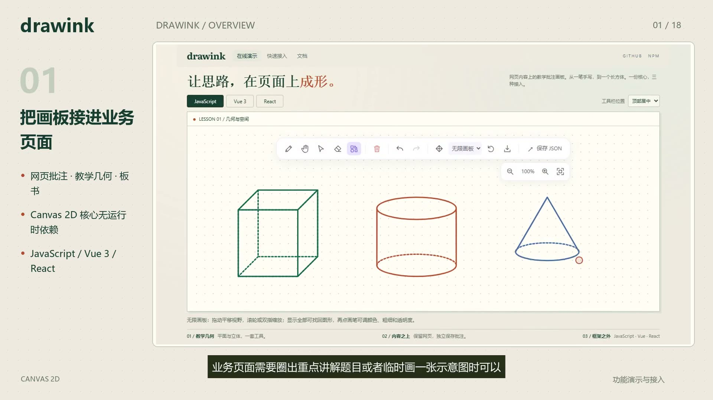

# drawink

**让思路，在页面上成形。**

drawink 是一个面向网页板书、教学几何和内容批注的画板库。它使用原生 Canvas 2D 绘制，提供无运行时依赖的 JavaScript 核心，以及 Vue 3、React 适配器。

**官网与在线演示：<https://jacky010.github.io/drawink/>**

[English](./README.md) · [MIT 许可证](./LICENSE)

### 完整功能介绍

GitHub README 无法直接内嵌仓库里的 mp4，点击封面即可在官网观看：

[](https://jacky010.github.io/drawink/?page=start#intro-video)

[在线观看](https://jacky010.github.io/drawink/?page=start#intro-video) · [下载视频](./media/drawink-intro.mp4)

## 目录

- [功能与适用场景](#功能与适用场景)
- [包与环境要求](#包与环境要求)
- [本地运行](#本地运行)
- [原生 JavaScript 接入](#原生-javascript-接入)
- [Vue 3 接入](#vue-3-接入)
- [React 接入](#react-接入)
- [文档批注与无限画板](#文档批注与无限画板)
- [工具与画笔](#工具与画笔)
- [工具栏与位置](#工具栏与位置)
- [背景配置](#背景配置)
- [保存与恢复数据](#保存与恢复数据)
- [导出 PNG](#导出-png)
- [配置参考](#配置参考)
- [方法参考](#方法参考)
- [自定义工具栏图标](#自定义工具栏图标)
- [扩展按钮与自定义形状](#扩展按钮与自定义形状)
- [输入、只读与生命周期](#输入只读与生命周期)
- [常见问题与使用边界](#常见问题与使用边界)
- [仓库结构与开发检查](#仓库结构与开发检查)
- [许可证](#许可证)

## 功能与适用场景

| 能力 | 说明 |
| --- | --- |
| 网页批注 | 保留宿主容器中的文字、图片等 DOM，在独立透明图层上绘制 |
| 教学几何 | 基础平面图形，以及带虚线辅助边的长方体、圆柱、圆锥 |
| 自由书写 | 支持画笔颜色、粗细与透明度设置 |
| 对象操作 | 按对象移动、按矩形范围擦除、撤销、重做与清空 |
| 两种画板模式 | 有限文档批注，以及可平移、缩放的无限画板 |
| 数据保存 | 版本化 JSON，不依赖 UI 框架和后端服务 |
| 图片导出 | PNG Data URL、PNG Blob，可选透明背景或画板背景 |
| 可扩展工具栏 | 自定义位置、图片/SVG/fonticon 图标、扩展按钮与形状 |
| 多种输入 | 鼠标、触屏、笔；无限模式支持双指平移与缩放 |

适合题目讲解、课件批注、网页板书、几何示意和固定布局文档上的标记。库本身不包含账号、上传接口、多人协作服务或课堂同步协议，数据如何存储由接入方决定。

## 包与环境要求

| 包 | 用途 | 框架要求 |
| --- | --- | --- |
| `@drawink/core` | Canvas 2D 核心，可直接用于 JavaScript/TypeScript | 无框架依赖 |
| `@drawink/vue` | Vue 组件，支持 `v-model:data` | Vue 3.3+ |
| `@drawink/react` | React 组件，支持受控数据与 ref API | React / React DOM 18+ |

三个包采用相同的数据格式、工具名称和核心配置。适配器依赖核心包，并重导出常用公共类型。

浏览器需要 Canvas 2D、Pointer Events 和 ResizeObserver。容器应具有明确高度。工具栏样式由库自动注入，不需要另外导入 CSS 文件。

以下为目标工程的依赖安装示例；需确保相应包在你使用的依赖源或本地依赖配置中可获取。本仓库内部已经通过 pnpm workspace 关联这些包，不需要再额外安装它们。

```bash
# 原生 JavaScript / TypeScript
npm install @drawink/core

# Vue 项目选择此包
npm install @drawink/vue

# React 项目选择此包
npm install @drawink/react
```

## 本地运行

仓库开发使用 pnpm 10，Node.js 要求 `^20.19.0 || >=22.12.0`。

```bash
cd drawink
pnpm install
pnpm dev
```

访问终端输出的本地地址。演示支持 JavaScript、Vue、React，技术栈和画板模式均在页面内切换，不重新加载整个页面；浏览器前进、后退也可切换相应视图。

需要固定端口时：

```bash
pnpm dev --port 5188 --strictPort
```

例如 `http://127.0.0.1:5188/?framework=vue&mode=infinite`。参数 `framework` 可选 `js`、`vue`、`react`，`mode` 可选 `document`、`infinite`。

演示按技术栈和画板模式分别保存当前标签页的会话数据。此行为由演示应用实现，不是所有业务系统必须采用的存储方式。切换会重新挂载画板，撤销历史不会跨实例保留。

## 原生 JavaScript 接入

```html
<div id="lesson" style="position: relative; width: 100%; height: 560px">
  <h2>圆柱的体积</h2>
  <p>V = πr²h</p>
</div>
```

```ts
import { Drawboard } from '@drawink/core'

const container = document.querySelector<HTMLElement>('#lesson')!
const board = new Drawboard(container, {
  mode: 'document',
  color: '#176b52',
  lineWidth: 3,
  opacity: 1,
  toolbarPosition: 'top-center',
  onChange(data) {
    // 将数据交给自己的状态层、存储服务或持久化逻辑。
    console.log(data)
  },
})

board.setTool('cylinder')
board.setBrush({ color: '#d9485f', lineWidth: 5, opacity: 0.7 })
const snapshot = board.getData()
board.loadData(snapshot)

// 页面或组件退出时销毁。
board.destroy()
```

同一容器只能拥有一个存活的核心实例。销毁会移除本实例创建的 DOM、观察器和事件监听，恢复其管理的宿主样式，保留原有内容；`destroy()` 可重复调用。

## Vue 3 接入

```vue
<script setup lang="ts">
import { ref } from 'vue'
import {
  Drawboard,
  type DrawboardHandle,
  type DrawboardOptions,
  type DrawingData,
} from '@drawink/vue'

const board = ref<DrawboardHandle>()
const data = ref<DrawingData>()
const options: DrawboardOptions = {
  mode: 'infinite',
  toolbarPosition: 'bottom-center',
  background: { color: '#fffdf6', pattern: 'dots', spacing: 20 },
}

async function saveImage() {
  const blob = await board.value?.exportBlob({ fit: true })
  if (blob) console.log(blob)
}
</script>

<template>
  <Drawboard
    ref="board"
    v-model:data="data"
    :options="options"
    style="width: 100%; height: 560px"
  />
  <button @click="board?.undo()">撤销</button>
  <button @click="saveImage">取得 PNG Blob</button>
</template>
```

| 入口 | 说明 |
| --- | --- |
| `data` / `v-model:data` | 绘图文档；更新数据时由适配器恢复到核心 |
| `options` | 核心配置；组件内部管理 `data`、`onChange` |
| `update:data` | 用于双向绑定 |
| `change(data)` | 绘图数据或视野等状态发生变更时通知 |
| `ready(instance)` | 核心实例创建后通知，参数为真实核心实例 |
| 默认插槽 | 文档模式下可放入文字、图片等底层内容 |
| 组件 ref | 暴露共享 `DrawboardHandle` 方法 |

组件卸载会自动销毁核心实例，不需要再手动销毁。无限模式通常使用空白容器；插槽中的普通 DOM 不会自动随无限相机移动。

## React 接入

```tsx
import { useRef, useState } from 'react'
import {
  Drawboard,
  type DrawboardHandle,
  type DrawboardOptions,
  type DrawingData,
} from '@drawink/react'

const options: DrawboardOptions = {
  mode: 'infinite',
  color: '#176b52',
  toolbarPosition: 'top-right',
}

export function LessonBoard() {
  const board = useRef<DrawboardHandle>(null)
  const [data, setData] = useState<DrawingData>()

  return <>
    <Drawboard
      ref={board}
      data={data}
      onChange={setData}
      options={options}
      style={{ width: '100%', height: 560 }}
    />
    <button onClick={() => board.current?.undo()}>撤销</button>
  </>
}
```

`data` 配合 `onChange` 构成受控用法；不传 `data` 时也可以由内部实例管理绘图。支持 `onReady(instance)`、`children`、常用 div 属性和 `style`。建议把稳定配置放在组件外，或使用 `useMemo`，避免不必要的配置更新。

适配器支持 StrictMode 的挂载清理流程，卸载时自动销毁实例。Vue/React 模块均可在 SSR 环境导入，服务端只渲染容器及其内容；实际画布在客户端挂载后创建。

## 文档批注与无限画板

| 项目 | `document` | `infinite` |
| --- | --- | --- |
| 默认模式 | 是 | 否 |
| 坐标 | 有限逻辑文档坐标 | 可平移的世界坐标，可为负值 |
| 浏览方式 | 滚轮滚动、`pan` 拖动滚动容器 | `pan` 平移、滚轮缩放、双指平移/缩放 |
| 长内容 | 使用 `contentHeight` | Canvas 位图保持可见区域大小 |
| 底层 DOM | 可以直接叠加批注 | 需要接入方自行管理其位置 |
| 视野保存 | 不保存容器滚动位置 | 保存 `viewport.x/y/zoom` |

长文档示例：

```ts
const board = new Drawboard(container, {
  mode: 'document',
  width: 800,
  height: 1200,
  contentHeight: 1200,
})
board.setTool('pan')
```

无限视野示例：

```ts
board.setMode('infinite')
board.setZoom(2) // 以可见区域中心缩放到 200%
board.setZoom(1.5, { x: 120, y: 160 }) // 锚点是视口内 CSS 像素
board.fitView(32) // 将全部图形放入视野，保留空隙
console.log(board.getViewport()) // { x, y, zoom }
board.resetView() // 回原点并恢复 100%，不删除图形
```

缩放范围为 `0.00001–8`，即 `0.001%–800%`。视野变化不改写图形端点，也不进入笔迹撤销历史。无限视图的笔宽按屏幕 CSS 像素显示，最低为 1.5px，避免缩小时亚像素线条变淡；原始 `Shape.width` 仍保持不变。

`autoPan` 默认开启。在无限模式绘制、移动对象或擦除时，将指针移到可见区域边缘并保持，可继续推进视野。设为 `false` 可关闭。

核心 `setMode()` 在切换后调用 `onModeChange`。如果该回调由应用负责重建画板，旧实例可能已被销毁，应使用新实例继续操作。未接管回调时，核心在当前数据上切换模式。不同模式是否使用独立文档，由应用决定。

## 工具与画笔

| 工具值 | 行为 |
| --- | --- |
| `pen` | 自由画笔，保存笔迹点序列 |
| `line` | 直线 |
| `rect` | 矩形 |
| `circle` | 圆，拖动两轴中较长的一轴决定直径 |
| `ellipse` | 椭圆 |
| `triangle` | 三角形 |
| `diamond` | 菱形 |
| `trapezoid` | 梯形 |
| `parallelogram` | 平行四边形 |
| `cuboid` | 长方体 |
| `cylinder` | 圆柱 |
| `cone` | 圆锥 |
| `select` | 按包围盒选中最上层对象并拖动 |
| `eraser` | 拖出矩形，删除包围盒与该区域相交的整个对象 |
| `pan` | 文档滚动，或无限视野平移 |

对象擦除不是像素擦除，移动工具也不是控制点缩放工具。目前不提供对象旋转、尺寸控制点或多对象编组。

```ts
board.setTool('pen')
board.setBrush({ color: '#176b52', lineWidth: 8, opacity: 0.5 })
const brush = board.getBrush() // { color, lineWidth, opacity }
```

再次点击已经选中的画笔按钮，会打开画笔设置面板。颜色、粗细和透明度影响之后绘制的笔迹与形状，不修改已有对象。旧数据缺少 `opacity` 时按 1 渲染。

## 工具栏与位置

默认工具栏将画笔、滚动/平移、移动、擦除独立显示，几何工具归入形状面板；包含历史、背景、模式、图片导出和无限模式视野操作。弹层支持外部点击关闭和 Escape 关闭。

```ts
const board = new Drawboard(container, {
  toolbarPosition: 'bottom-right',
})

board.setOptions({ toolbarPosition: { x: 24, y: 72 } })
```

预设值为 `top-left`、`top-center`、`top-right`、`bottom-left`、`bottom-center`、`bottom-right`，默认 `top-center`。自定义 `{ x, y }` 相对容器可见区域左上角，以 CSS 像素计量；超出容器时会约束到可用范围内。

工具栏通过原生固定层保持在画板可见区域中，内部文档滚动时不会依赖异步滚动补偿上下移动；底部位置的菜单向上展开。容器改变尺寸时会重新定位。位置配置不是绘图内容，不写入 JSON。

需要完全自建工具栏时传入 `toolbar: false`，再调用公开方法。演示中的技术栈导航和位置选择框属于演示页面，不会作为库的额外页面 UI 注入业务系统。

## 背景配置

```ts
board.setBackground({
  color: '#fffdf6',
  pattern: 'grid', // 'none' | 'dots' | 'grid'
  patternColor: '#cdd8ce',
  spacing: 24,
})
const settings = board.getBackground()
```

| 字段 | 文档模式默认值 | 无限模式默认值 | 约束 |
| --- | --- | --- | --- |
| `color` | `transparent` | `#fffdf6` | `transparent` 或 3/4/6/8 位十六进制颜色 |
| `pattern` | `none` | `dots` | `none`、`dots`、`grid` |
| `patternColor` | `#cdd8ce` | `#cdd8ce` | 与背景颜色相同的格式约束 |
| `spacing` | `20` | `20` | `4–200` |

背景位于宿主 DOM 后方，不会盖住文档文字。文档模式未配置背景时保留宿主原有背景样式。`setBackground` 和 `setOptions({ background })` 都采用字段合并；`getBackground()` 返回补齐默认值的设置。

无限模式下纹理随视野变化，密度过高时改用更疏的网格层级，使极小缩放时点阵/网格仍可见。保存的数据仍保留原始间距。背景设置可以随 JSON 保存，但导出图片是否带背景由导出参数单独决定。

## 保存与恢复数据

```ts
const snapshot = board.getData()
const json = JSON.stringify(snapshot)

// 从自己的存储服务读取后恢复：
board.loadData(json)
```

公共数据结构：

```ts
interface DrawingData {
  version: 1
  mode?: 'document' | 'infinite'
  viewport?: { x: number; y: number; zoom?: number }
  background?: {
    color?: string
    pattern?: 'none' | 'dots' | 'grid'
    patternColor?: string
    spacing?: number
  }
  width: number
  height: number
  shapes: {
    tool: string
    points: { x: number; y: number }[]
    color: string
    width: number
    opacity?: number
  }[]
}
```

- 缺少 `mode` 的旧数据按文档模式加载；缺少 `viewport.zoom` 时按 1 恢复。
- 普通形状保存两个端点，`pen` 保存完整笔迹；自定义形状通过注册的 id 识别。
- `getData()` 返回与当前图形点数据分离的快照，修改返回对象不会直接修改画板。
- `loadData()` 会先校验完整文档，成功后替换当前图形并重置撤销历史；校验失败时保留现有文档。
- `loadData()` 不触发 `onChange`，避免受控数据回流；改变画笔设置也不会立即生成新的绘图数据。
- 背景、已提交绘图和视野变化可触发 `onChange`。未完成笔画不包含在快照中。
- JSON 不保存回调、图标工厂、自定义绘图函数和撤销历史，不兼容 Fabric JSON。

初次创建时显式 `options.mode/background/zoom` 优先于初始 `data` 的相应值；后续 `loadData` 或组件 `data` 更新按新文档恢复。宿主 DOM 布局不会随 JSON 自动重建。

## 导出 PNG

### 使用默认工具栏

点击“导出 PNG”图标，按需勾选“包含背景”，然后点击“保存图片”。每次打开默认不勾选背景，文件名为 `drawink.png`。

工具栏使用自动适配导出：保存全部已提交图形，包含离屏和负坐标区域，将图片每条边控制在 4096px 以内，保留可读笔宽和图片留白，避免极小缩放下世界坐标尺寸过大导致失败。

### 使用 API

```ts
// 大画板通常使用自动适配：
const transparent = await board.exportImage({ fit: true })
const withBackground = await board.exportImage({
  fit: true,
  includeBackground: true,
})
const blob = await board.exportBlob({ fit: true })

// 明确需要原始逻辑比例时：
const original = await board.exportImage({ scale: 1 })
```

| 参数 | 默认值 | 说明 |
| --- | --- | --- |
| `fit` | `false` | 自动限制输出尺寸；无限模式采用可读的显示笔宽，并额外留白 |
| `scale` | `1` | 逻辑导出倍率；开启 `fit` 后可能进一步缩小 |
| `includeBackground` | `false` | 包含当前背景颜色及纹理 |
| `background` | 不设置 | 指定导出底色；启用 `includeBackground` 时覆盖底色并保留纹理 |

`exportImage()` 返回 PNG Data URL 的 Promise，`exportBlob()` 返回 PNG Blob 的 Promise。两者都只导出已提交批注，不包含工具栏、底层网页文字、图片或 iframe 截图。

未开启 `fit` 时，文档模式按逻辑文档尺寸导出，无限模式按全部图形的包围盒加 16 个逻辑像素边距导出。此路径使用保存的逻辑笔宽，不因当前视野缩放而改变，超过约 6400 万像素或单边 32768px 会拒绝。

自动适配路径不改变 JSON 中的点或笔宽，带背景时会保持可见的纹理层级。非自动导出中，小于 4 个输出像素间距的过密纹理可以省略。用户设置了透明背景时，即使勾选背景也不会强制生成不透明底色。

Blob 下载示例：

```ts
const blob = await board.exportBlob({ fit: true })
const url = URL.createObjectURL(blob)
const link = document.createElement('a')
link.href = url
link.download = 'lesson.png'
link.click()
setTimeout(() => URL.revokeObjectURL(url), 1000)
```

## 配置参考

配置类型为 `DrawboardOptions`，核心构造函数和 Vue/React 的 `options` 使用同一套字段；组件的数据和变更回调使用各自顶层绑定。

| 字段 | 默认值 | 说明 |
| --- | --- | --- |
| `mode` | `document` | `document` / `infinite` |
| `width` / `height` | 宿主初始尺寸，零尺寸时回退 800 / 600 | 初始逻辑文档尺寸；初始 `data` 中的尺寸优先 |
| `contentHeight` | 不设置 | 文档 CSS 内容高度，启用长文档滚动 |
| `tool` | `pen` | 内置工具或已注册自定义形状 id |
| `color` | `#176b52` | 后续对象使用的有效 CSS 颜色 |
| `lineWidth` | `3` | 大于 0 且不超过 32768；文档逻辑笔宽，无限视图按屏幕笔宽显示 |
| `opacity` | `1` | 后续对象透明度，`0–1` |
| `zoom` | `1` | 初始无限视野倍率，`0.00001–8` |
| `toolbar` | `true` | 是否显示默认工具栏 |
| `toolbarPosition` | `top-center` | 六种预设，或 `{ x, y }` |
| `toolbarIcons` | 不设置 | 按控件/形状/扩展 id 覆盖图标 |
| `toolbarItems` | 空 | 扩展操作数组 |
| `shapes` | 空 | 自定义形状定义数组 |
| `background` | 按模式补齐 | 背景字段，见背景配置 |
| `autoPan` | `true` | 无限模式绘制/移动/擦除时的边缘视野推进 |
| `disabled` | `false` | 画布不接收指针，让底层 DOM 可以被操作 |
| `readOnly` | `false` | 禁止图形编辑和历史操作，保留浏览与缩放 |
| `penOnly` | `false` | 忽略手指绘图，仍允许鼠标、笔和无限模式双指导航 |
| `historyLimit` | `100` | 历史状态数量，整数且至少为 2，仅构造时设置 |
| `data` | 空文档 | 核心初始数据；组件使用顶层 `data` |
| `onChange` | 无 | 核心变更回调；组件使用事件或 `onChange` 属性 |
| `onModeChange` | 无 | 核心切换模式后通知应用 |

`setOptions()` 合并运行时配置。`background` 按字段合并，图标映射、扩展按钮和形状数组按传入值替换。逻辑 `width`、`height` 和 `historyLimit` 是构造设置；修改已有文档尺寸应使用 `loadData()`，并按业务需求同步 `contentHeight` 与 DOM 布局。

## 方法参考

以下方法由核心实例和 Vue/React 的 `DrawboardHandle` 共同提供：

| 方法 | 返回值 | 说明 |
| --- | --- | --- |
| `getData()` | `DrawingData` | 取得当前图形快照，不含新笔画草稿 |
| `loadData(dataOrJson)` | `void` | 校验、恢复文档并重置历史 |
| `setTool(tool)` | `void` | 切换工具 |
| `setMode(mode)` | `void` | 切换模式并通知 `onModeChange` |
| `setOptions(options)` | `void` | 更新运行时配置 |
| `getBrush()` | `BrushSettings` | 返回颜色、粗细、透明度 |
| `setBrush(partial)` | `void` | 更新后续绘图样式 |
| `getBackground()` | 完整背景设置 | 返回补齐默认值的背景 |
| `setBackground(partial)` | `void` | 合并背景并通知变更 |
| `getViewport()` | `{ x, y, zoom }` | 返回无限视野状态 |
| `setZoom(zoom, anchor?)` | `void` | 无限模式缩放，默认中心锚点 |
| `fitView(padding = 32)` | `void` | 无限模式显示全部图形；空画板回原点 |
| `resetView()` | `void` | 重置无限相机/倍率，或将文档滚到原点 |
| `registerShape(definition)` | `void` | 向当前实例追加自定义形状 |
| `undo()` / `redo()` | `boolean` | 成功恢复状态时返回 `true` |
| `clear()` | `void` | 清空对象，可撤销；只读/禁用时不执行 |
| `refresh()` | `void` | 刷新视口尺寸；通常由 ResizeObserver 自动完成 |
| `exportImage(options?)` | `Promise<string>` | 导出 PNG Data URL |
| `exportBlob(options?)` | `Promise<Blob>` | 导出 PNG Blob |

核心实例额外提供 `canUndo`、`canRedo`、`tool`、`mode` 和 `destroy()`；`canUndo/canRedo` 表示历史是否存在，不等于编辑权限。框架 ref 不暴露手动销毁方法，由框架生命周期负责清理。ref 方法应在组件挂载后使用。

`fitView` 是调整屏幕视野，`exportImage({ fit: true })` 是适配导出图片尺寸，两者用途不同。

## 自定义工具栏图标

`toolbarIcons`、`ToolbarItem.icon` 和 `CustomShapeDefinition.icon` 共用 `ToolbarIcon`。优先级为 `toolbarIcons[id]`、对应定义中的 `icon`、内置图标。

```ts
board.setOptions({
  toolbarIcons: {
    pen: { type: 'image', src: '/icons/pen.png' },
    eraser: {
      type: 'svg',
      content: '<svg viewBox="0 0 24 24"><path d="M4 14 14 4l6 6-10 10H8Z" fill="none" stroke="currentColor"/></svg>',
    },
    pan: { type: 'font', className: 'iconfont icon-hand' },
    'export-png': { type: 'font', className: 'iconfont', text: '\ue600' },
    reset: '↺',
  },
})
```

也可以传入 DOM 工厂 `(doc) => Node`。使用传入的 `doc` 创建节点可以兼容不同 Document；返回节点会被克隆，多个实例不会争用同一图标节点。

图标键包括：`pen`、`pan`、`select`、`eraser`、`shapes`、`clear`、`undo`、`redo`、`background`、`reset`、`export-png`、`zoom-in`、`zoom-out`、`zoom-reset`、`fit-view`，以及内置/自定义形状 id、扩展按钮 id。模式切换是 select，不是独立图标键。

字符串按文字处理，不解释为 HTML。内联 SVG 请使用 `{ type: 'svg', content }`；SVG 使用允许列表过滤脚本、事件和外部资源引用。图片支持相对路径、HTTP(S)、Blob 及允许的图片 data URL。fonticon 的字体文件和 CSS 由应用自行加载。DOM 工厂是接入方执行的代码，应使用可信实现。

## 扩展按钮与自定义形状

### 增加按钮

```ts
import type { ToolbarItem } from '@drawink/core'

const toolbarItems: ToolbarItem[] = [{
  id: 'save-document',
  label: '保存文档',
  icon: '↗',
  disabled: api => api.getData().shapes.length === 0,
  onClick(api) {
    const document = api.getData()
    console.log(document)
  },
}]

board.setOptions({ toolbarItems })
```

扩展操作收到共享 Handle，可以读取数据、切换工具、导出图片等。`disabled` 可为布尔值或函数；扩展按钮的禁用策略由定义决定，如需跟随业务只读状态，应自行同步配置。应用负责扩展回调中的网络、文件或其他业务操作。

### 增加形状

```ts
import type { CustomShapeDefinition } from '@drawink/core'

const badge: CustomShapeDefinition = {
  id: 'badge',
  label: '标记框',
  icon: '▧',
  draw(ctx, shape) {
    const [a, b] = shape.points
    ctx.beginPath()
    ctx.rect(
      Math.min(a.x, b.x), Math.min(a.y, b.y),
      Math.abs(b.x - a.x), Math.abs(b.y - a.y),
    )
    ctx.stroke()
  },
}

board.registerShape(badge)
board.setTool('badge')
```

也可在构造配置中传 `shapes: [badge]`。定义只属于当前实例，不使用全局注册表。

id 应匹配 `^[a-z][a-z0-9-]*$`，唯一且不能占用内置工具名。绘制函数使用世界坐标，颜色、透明度和当前渲染线宽已预设；通常应使用现有 `ctx.lineWidth`，避免覆盖无限视图的笔宽换算。几何内容应限制在两个端点定义的矩形内，以保证包围盒移动、选择、擦除和导出边界一致。

JSON 只存 id，不保存绘图函数，恢复之前必须注册对应定义。仍被当前图形或撤销/重做历史引用的定义不能移除；需要先加载不包含该形状的文档以重置历史，再替换 `shapes`。移除当前选中的空闲自定义工具后会回退到画笔。

## 输入、只读与生命周期

- 普通指针取消、丢失捕获和窗口失焦会停止未完成手势；取消绘制/移动时恢复手势前的图形和视野。
- 无限模式双指导航会取消未提交的单指笔迹，所有手指松开后再恢复单指绘图。
- `penOnly` 仅根据 Pointer Events 的设备类型区分手指与笔，不等于硬件级掌压识别。
- `readOnly` 阻止对象绘制、移动、擦除、清空和历史操作；允许无限视野浏览、缩放和图片导出。
- `disabled` 让画布不接收指针事件，便于点击、选择底层网页内容。自定义工具栏按钮仍应遵守应用定义的禁用策略。
- 容器尺寸变化会自动刷新，但 DOM 文本换行、图片加载或原文档重排不会自动重新绑定批注锚点。
- 不要在 Vue/React 适配器管理的同一 DOM 上再次手动创建核心实例。销毁后不要继续复用旧实例。

## 常见问题与使用边界

**为什么没有看到画板？** 检查容器是否已挂载、宽高是否有效、是否被祖先隐藏。适配器设置了基础最小高度，但业务布局仍应提供明确的可见区域。

**为什么在文档底部无法继续滚动？** 需要给文档模式设置大于可见区域的 `contentHeight`。为固定布局长文档保持逻辑高度、内容高度与 DOM 布局一致。

**为什么网页内容没有随无限画板移动？** 无限相机只变换绘图层；普通 DOM 由业务系统管理。需要保留网页阅读布局时使用文档模式。

**为什么改粗细没有修改已有笔迹？** 画笔设置只作用于新对象；已有对象的样式保存在各自 Shape 中。

**为什么加载之后不能撤销到旧文档？** `loadData()` 把新文档设为历史起点，历史不是文档 JSON 的一部分。

**为什么原尺寸导出失败？** 大世界范围会使输出超出内存预算。使用工具栏导出，或显式传 `{ fit: true }`。

**为什么 PNG 没有网页原文？** 输出仅包含批注及可选画板背景，不包含 DOM 截图。需要合成原文时，由应用把 PNG 与内容截图组合。

**为什么 JSON 中的自定义形状无法恢复？** 核心不执行文档里携带的绘图代码；请先注册同 id 定义，再加载数据。

**支持任意 CSS 变换吗？** 支持轴对齐 scale，不支持宿主 rotate/skew。宿主布局、定位和批注内容重排仍由应用管理。

**坐标和内存有上限吗？** 文档宽高和逻辑线宽上限为 32768，图形点坐标范围为 ±1,000,000,000,000,000，相机位置范围为 ±1,000,000,000。边界处会限制生成的坐标，保证自身 JSON 可重新加载。交互位图按约 3200 万像素预算及最多 2 倍设备像素比控制。

**是否适合无限数量对象？** 当前渲染会遍历图形，历史按状态快照保存。`historyLimit` 限制状态数量，不是字节数。海量笔迹、移动 WebView 和实际数位笔应按目标设备验证；尚未提供空间索引、笔迹压缩或分块存储。

## 仓库结构与开发检查

```text
packages/core/src/   核心、渲染、数据模型、工具栏与公共类型
packages/vue/src/    Vue 组件适配器
packages/react/src/  React 组件适配器
playground/         三种技术栈共用的本地演示工作台
tests/              数据模型等单元测试
e2e/                浏览器交互、布局和实际下载回归
scripts/            本地构建包校验脚本
```

```bash
pnpm test          # 单元测试
pnpm typecheck     # TypeScript 检查
pnpm test:e2e      # Playwright 浏览器回归
pnpm build         # 构建三个包的 ESM、CJS 和类型声明
pnpm check:pack    # 本地打包内容、许可证、模块和 SSR 导入检查
```

浏览器测试使用 Playwright 配置中的浏览器。已安装 Chrome 时可设置 `PLAYWRIGHT_CHANNEL=chrome`；Windows PowerShell 示例：

```powershell
$env:PLAYWRIGHT_CHANNEL = 'chrome'
pnpm test:e2e
```

`check:pack` 只在本地产生构建包和进行检查，产物位于 `artifacts/`。框架 SSR 检查只验证服务端容器渲染与导入，不会在服务端创建 Canvas。

### 发布

使用 [changesets](https://github.com/changesets/changesets) 管理版本，三个包版本号保持一致。

1. 在功能分支执行 `pnpm changeset`，描述本次改动并提交；
2. 合并进 `master` 后，Release 工作流会自动创建「Version Packages」PR；
3. 合并该 PR 即通过 npm 可信发布（Trusted Publishing）发到 npm，无需 token（需在 `@drawink/core`、`@drawink/vue`、`@drawink/react` 的 npm 设置里，把 `Jacky010/drawink` 的 `release.yml` 登记为 Trusted Publisher）。

手动发布：`pnpm version-packages && pnpm release`。

## 许可证

项目采用 [MIT License](./LICENSE)。使用和分发时请保留许可证要求的版权声明与许可文本。第三方依赖仍遵循各自的许可证。
